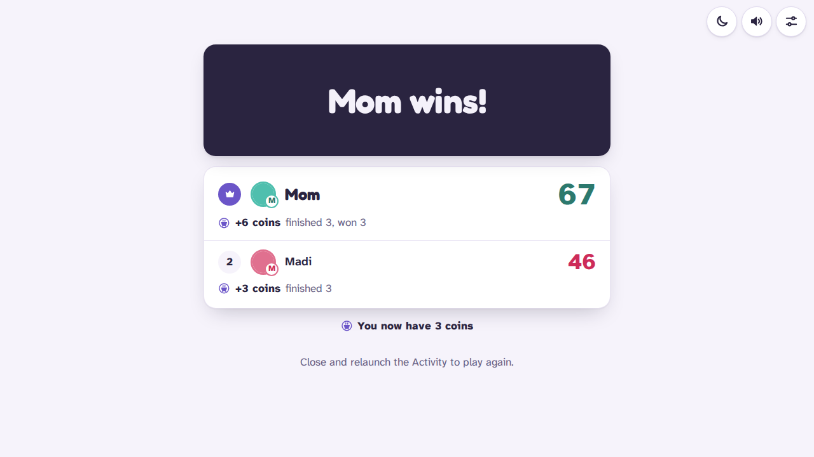

# Task 03 Proofs - Payout message, snapshot field and the Results screen coin line

## Task Summary

This task shows players what they earned. After the server pays a finished game it sends each client a payout message (everyone's earnings, plus that client's own new balance), and puts the same payout in the snapshot for anyone who joins or comes back later. The Results screen then shows a coin line under each paid player and the viewer's balance underneath.

## What This Task Proves

- Every connected client, including a spectator, receives the payout after the final move. Players get their own balance and a spectator gets `null`.
- A player who joins or reconnects after the game ended gets the same payout in their snapshot.
- No payout is sent before the game is finished, when nobody was paid (guests with payouts off), or when recording the payout failed.
- The Results screen shows the winner and standings first with no coin lines, then adds the coin lines and balance once the payout arrives.
- In a real browser game the coin lines and balance appear, with the same amounts on both players' screens, and with reduced motion they are simply there.

## Evidence Summary

- 4 new room tests cover the live message, the snapshot, no payout before the end, and no payout when nobody was paid.
- 9 `payoutView` tests and 4 `Results` render tests cover the text and the screen.
- A Playwright test plays a full game between two guests and checks the coin lines, the balances and the reduced-motion path. All 6 e2e tests pass.
- The screenshot below shows the settled Results screen from a real game.

## Artifact: Room payout message and snapshot tests

**What it proves:** The server sends each client its own payout and balance, includes it in later snapshots, and stays quiet when there is nothing to report.

**Why it matters:** Reconnecting players must still see what they earned, and a spectator must not be handed someone else's balance.

**Command:**

```bash
pnpm exec vitest run apps/server/src/rooms/TableRoom.test.ts
```

**Result summary:** 29 tests passed (up from 25): `tells every client what was earned, and each their own balance`, `puts the payout in the snapshot of anyone who joins or comes back later`, `sends no payout before the game is finished` and `sends no payout when nobody was paid`. The failing-database test also checks nobody is sent a payout.

## Artifact: Display helper and Results render tests

**What it proves:** The text is right (`+1 coin`, `+23 coins`, breakdown without zero parts, `You now have N coins`), Results renders cleanly without a payout, a spectator sees amounts but no balance, and only paid players get a line.

**Why it matters:** The web package has no DOM test setup, so these tests render the real `Results` screen to a string. That makes the "results first, coins after" order testable without a browser.

**Command:**

```bash
pnpm exec vitest run apps/web/src/payoutView.test.ts apps/web/src/screens/Results.test.tsx
```

**Result summary:** 13 tests passed (9 and 4).

## Artifact: Results screen after a real game

**What it proves:** In a production build, two guests play a full 1-card game, and each sees the coin lines, a breakdown, the cauldron coin icon and their own balance.

**Why it matters:** This is the player-facing result of the whole slice, and it is the first time the payout is visible on screen.

**Artifact path:** `docs/specs/01-spec-coins-and-payouts/01-proofs/results-coins.png`

**Result summary:** Mom won with +6 coins (finished 3, won 3) and Madi got +3 coins (finished 3). The picture is Madi's screen, which says "You now have 3 coins". A 1-card game pays 3 for finishing and 3 for winning; the 3-card amounts (10 and 10) are covered by the unit tests in task 01. The picture was taken after the entrance animations finished.



## Artifact: End-to-end browser test

**What it proves:** The coin lines appear on both players' screens with matching amounts, each balance equals that player's own earnings (their first game), and in a browser with reduced motion on the coin line is fully visible with no fade left.

**Why it matters:** It confirms the pieces work together in the production build, and that the existing game and Results tests still pass.

**Command:**

```bash
task build && task e2e
```

**Result summary:** 6 passed (3.7 minutes), including `a finished game shows each player what they earned, and their new balance`, both existing 1-card game tests and the reload test.

## Artifact: Contrast

**What it proves:** The coin text meets WCAG AA in every theme and scheme.

**Why it matters:** The repository checks every text pairing in `palette.test.ts`.

**Result summary:** The coin line uses the existing `text` and `quiet` colors on the `pad` and `bg` backgrounds, which are already in `TEXT_PAIRS`, so no new pairing was added and `palette.test.ts` is unchanged and passing. The icon is decorative (`aria-hidden`).

## Artifact: Lint, typecheck and full test run

**Result summary:** `task lint` and `task typecheck` pass. `task test`: 23 files, 352 tests passed, `packages/rules` at 100% on every measure.

## Reviewer Conclusion

Players now see what they earned the moment a game ends, and again if they reconnect. The payout is optional on screen: if there is none, Results looks exactly as before.

## Notes

- This commit also renames the balance table from `players` to `wallets`, because an earlier reverted version of coins left a differently shaped `players` table in some databases (see the tasks file notes). A test covers a database that still has the old tables.
- `e2e/playwright.config.ts` now gives the e2e server its own data directory so test games do not write coins into the dev database.
- The shared Playwright helpers moved to `e2e/tests/helpers.ts` and the coins e2e test (task 4.1) was written here because the screenshot needed it.
