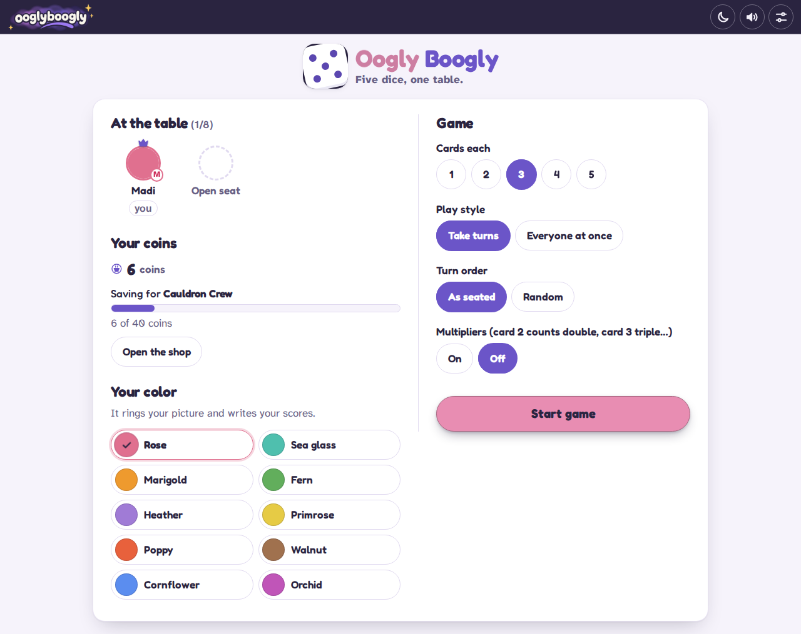
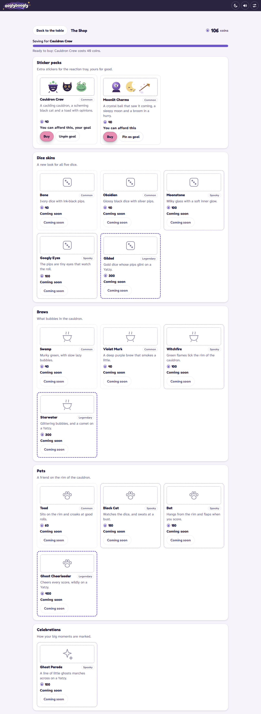

# Task 03 Proofs - The Shop screen, lobby balance and goal pin

## Task Summary

The lobby now shows the player's coins, a goal bar and an "Open the shop" button, and what each seat is wearing. The Shop screen lists the packs and every catalog item with a clear state, a two-tap Buy, Wear it and Take off, and a goal pin.

## What This Task Proves

- Every card shows name, rarity, price and blurb, and one state in words: owned (or wearing it), can afford, N coins short, coming soon.
- Coming-soon items have a disabled button and no Buy or Pin.
- Buying needs a confirmation naming the price; "Not now" spends nothing.
- The goal bar shows coins toward the price, with numbers beside it.
- Only existing theme tokens are used, so the pairs in `palette.test.ts` still cover every text color. Motion in the shop is under `prefers-reduced-motion: no-preference` only.

## Evidence Summary

- `shopView.test.ts` (pure helpers) and `Shop.test.tsx` (16 `renderToString` tests of the Shop, the panel and the lobby) pass.
- Screenshots below come from the browser test in task 5.

## Artifact: Lobby with a pinned goal



(Taken before the coin panel was moved above "Your color"; it now sits right under the seats.)

## Artifact: The Shop



The two packs are affordable (106 coins), the first is the pinned goal ("Ready to buy"); everything else is "Coming soon" with a dashed frame and a quiet placeholder glyph. Rarity is a word, with a heavier frame for rarer items.

## Command

```bash
pnpm exec vitest run apps/web/src/shop
```

**Result summary:** all pass.

## Honest limits

- The placeholder glyphs are the same for every item in a slot; real previews arrive with specs 03 and 04.
- No test measures the color contrast of the new CSS itself. It uses only `--text`, `--quiet`, `--strong` (decoration) and `--on-accent` through the shared `button.primary`, all pairs already in `palette.test.ts`.
