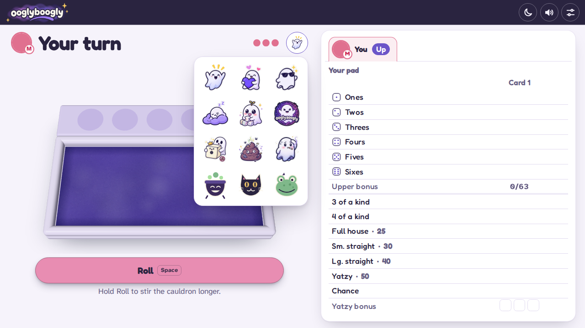

# Task 04 Proofs - Sticker packs

## Task Summary

Two packs of three witchy vector stickers, a picker that shows a pack's stickers only once it is owned, and prompts for the real art.

## What This Task Proves

- The picker offers the nine free stickers to everyone and a pack's three only to its owner (`Reactions.test.tsx`; the server refuses the rest, see task 2).
- Every sticker id has art and a label.
- In a real browser the tray holds the free stickers plus the owned pack, and not the other pack (`shop.spec.ts`).

## Artifact: The tray after buying Cauldron Crew



Nine ghosts, then the cauldron, cat and toad. Moonlit Charms is not owned, so its stickers are absent.

## Artifact: Prompts

`../nano-banana-prompts.md` has a shared style block and six prompts, one per sticker (`cackle`, `mischief`, `ribbit`, `foresaw`, `moonMood`, `broom`), in the style of the existing ghost stickers.

## Command

```bash
pnpm exec vitest run apps/web/src/Reactions.test.tsx
```

**Result summary:** all pass.

## Honest limits

- The placeholders are flat vector and noticeably simpler than the ghost art; that is expected until the Nano Banana art is generated.
- The sent sticker floating on another player's screen is covered by the existing reaction code, which looks art up by id; the e2e checks the sender's own float.
