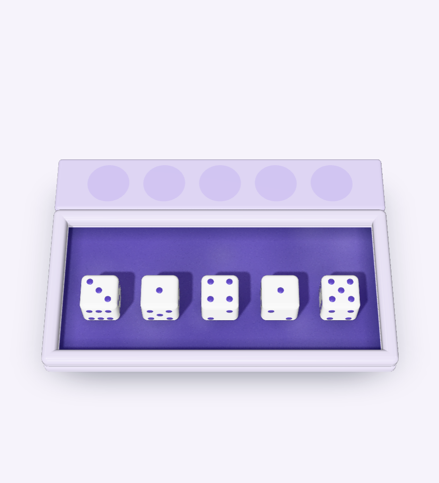
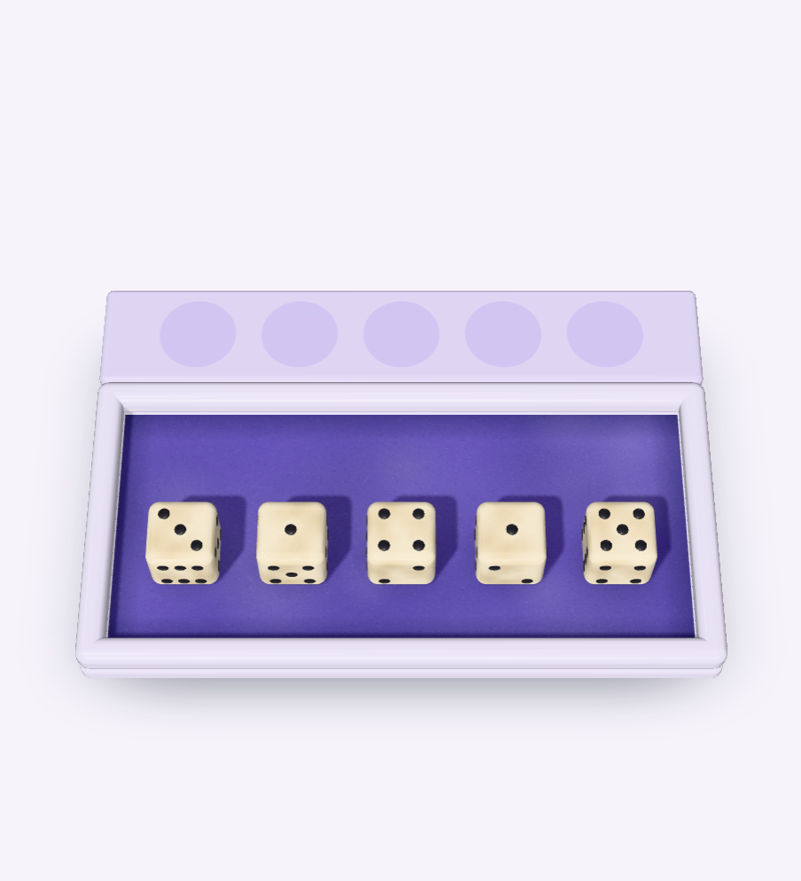
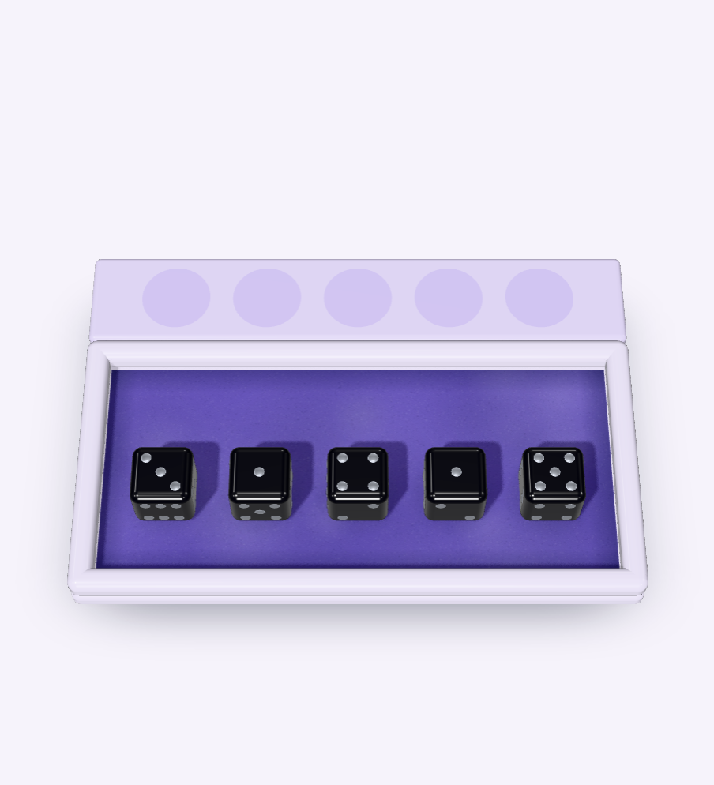
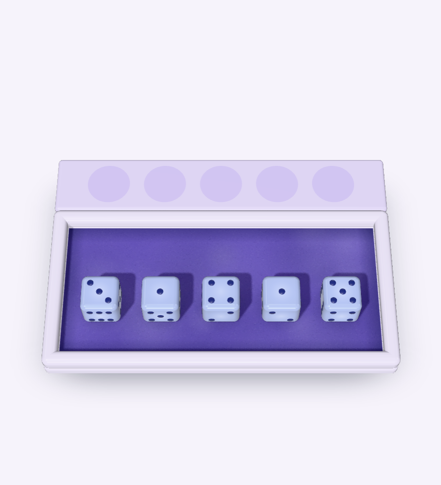
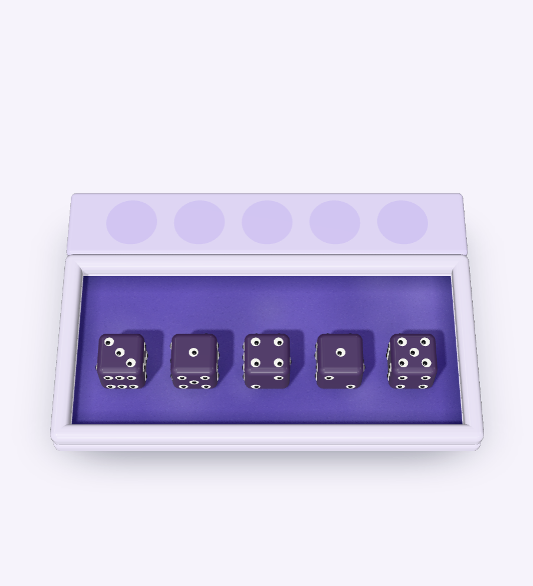
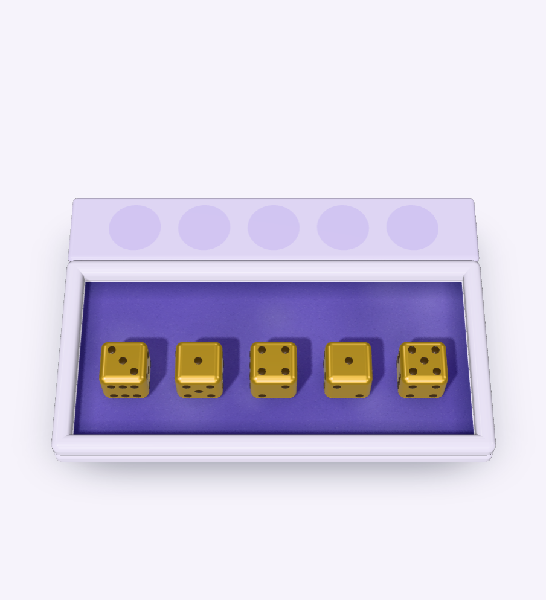
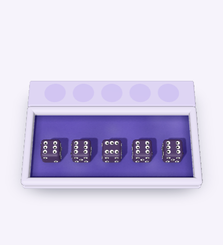
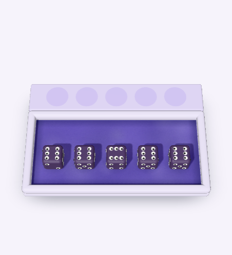
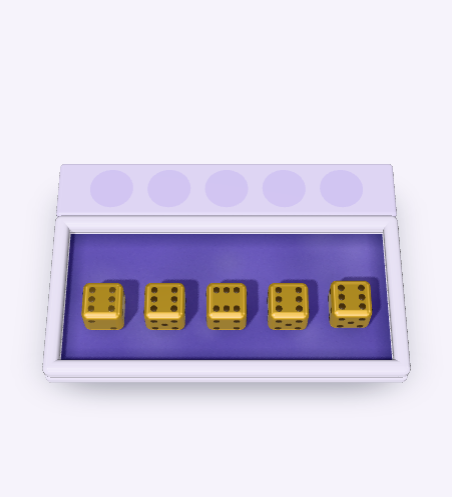
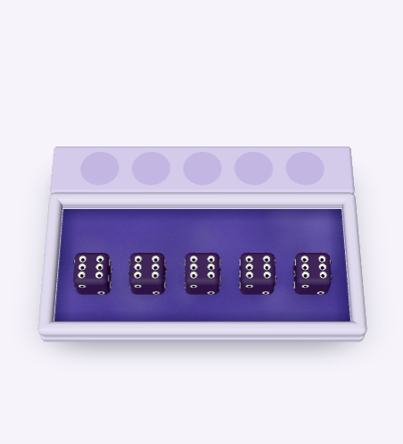

# Task 02 Proofs - Dice skins in the scene

## Task Summary

This task draws the five dice in the skin of the player whose tray is shown. `Game.tsx` passes that seat's `equipped` to `DiceTray`, which turns it into a `look` for the scene; `Dice` builds its materials through a `SkinRig`. With nothing equipped the rig builds the same porcelain materials as before.

## What This Task Proves

- Each of the five skins draws and is readable: bone (ivory, ink pips), obsidian (glossy black, silver pips), moonstone (milky periwinkle glass with an inner glow on each face), googly (plum dice with white eyes that follow the camera) and gilded (gold, bronze pips).
- The default look is unchanged: the default screenshot is the porcelain die, `pipGeometry` is checked against a checksum of the old output, and the no-skin rig is tested to build the porcelain materials.
- Googly pupils move on their own faces while the dice tumble, and gilded pips flare in turn with star glints on a Yatzy.
- With reduced motion the eyes stay centered, the glow holds still and there are no glints.

## Evidence Summary

- Pictures were taken with headless Chromium on SwiftShader (software WebGL), `?quality=high` to use the rich materials a real GPU gets. There is no GPU here, so frame rates were not measured.
- `dieModel.test.ts` and `skinRig.test.ts`: 20 tests pass; the full suite is 402 tests.
- Mid-roll and Yatzy frames were taken with a slow-motion clock (page clock and timers at one tenth speed) so they land on known moments of the roll.

## Artifact: The default look is unchanged

**What it proves:** With nothing equipped the tray draws the white porcelain dice with violet pips.

**Why it matters:** The default must not change at all.

**Command:** `pnpm exec vitest run apps/web/src/dice/dieModel.test.ts apps/web/src/cosmetics/skins/skinRig.test.ts` shows the golden pip checksum and the porcelain-materials test passing.

## Artifact: The five skins

| Skin        | Settled roll                         |
| ----------- | ------------------------------------ |
| Bone        |            |
| Obsidian    |    |
| Moonstone   |  |
| Googly Eyes |        |
| Gilded      |        |

**What it proves:** Every skin draws in the real tray, with pips readable against the body.

**Why it matters:** These are the nine items' first five; the owner can judge the look before the shop sells them.

**Command:** `?lab&values=3,1,4,1,5&auto=1&quality=high&cosmetics=diceSkin:<id>` on the dev server, screenshot after the roll settles.

## Artifact: Googly eyes mid-roll

 

**What it proves:** The eyes are drawn on every face while the dice tumble, and keep their pupils on the die.

**Why it matters:** Pupils are moved in a vertex shader from the gaze in the die's own space; `skinRig.test.ts` checks that turning the die turns the gaze with it.

## Artifact: Gilded Yatzy glint

**What it proves:** On a Yatzy the pips flare bright gold die by die, with a star glint at each.

**Why it matters:** This is the legendary skin's payoff. `skinRig.test.ts` proves the stagger, that the effect ends, and that reduced motion skips it.

## Artifact: Reduced motion

**What it proves:** With the system's reduced-motion setting on, a Yatzy with googly dice and starwater settles without a cauldron or comet, and the eyes sit centered.

**Why it matters:** The spec asks for calm materials and no particle motion.
