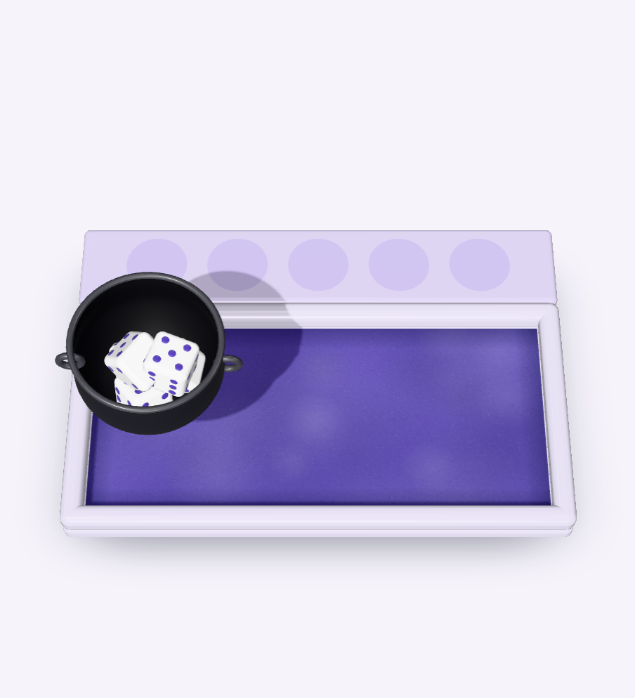
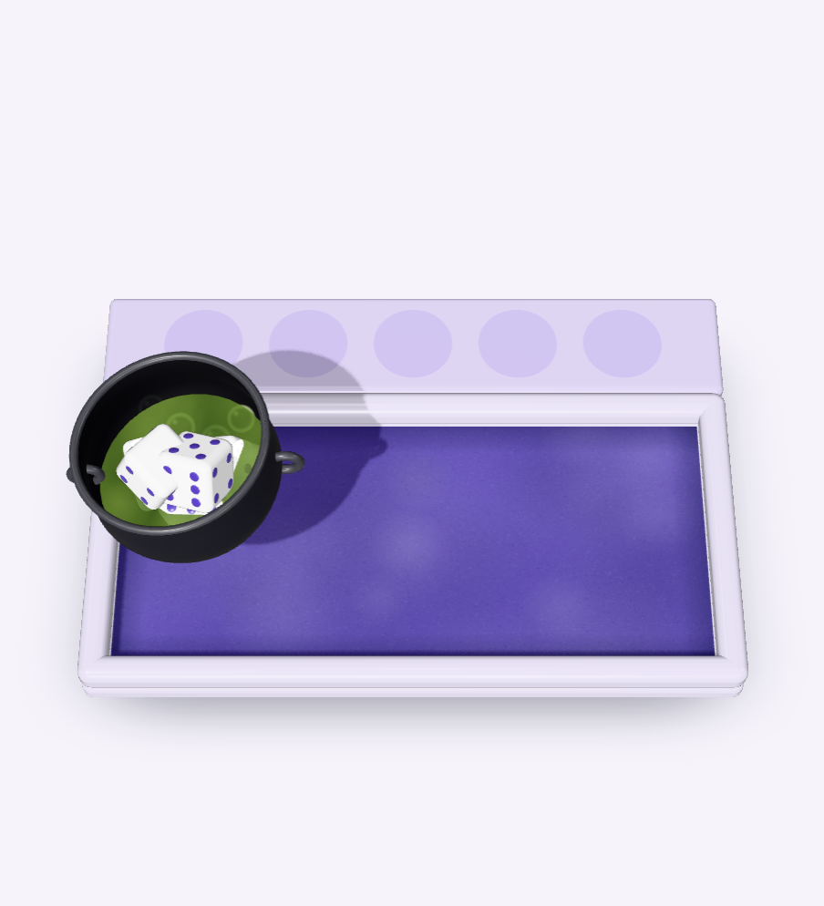
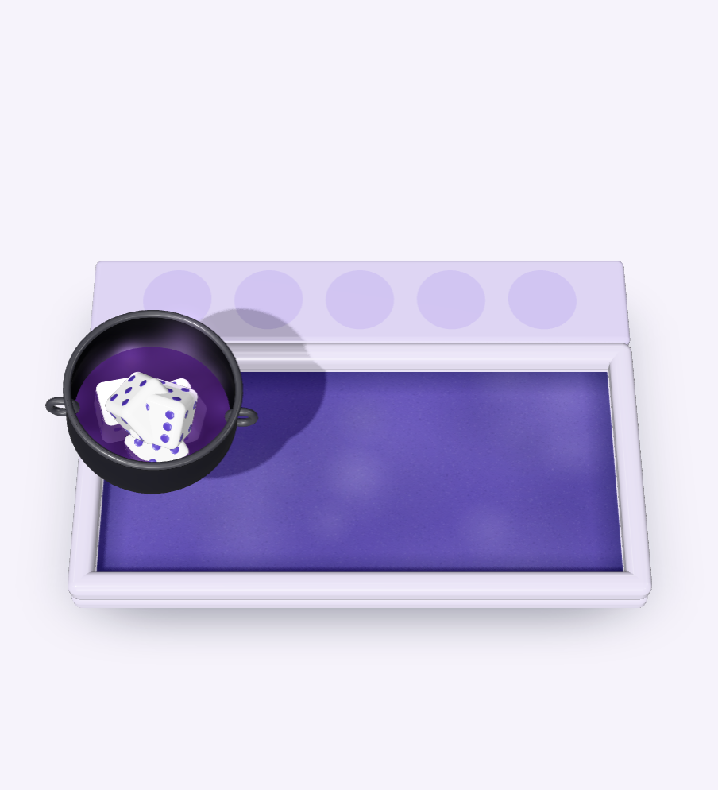
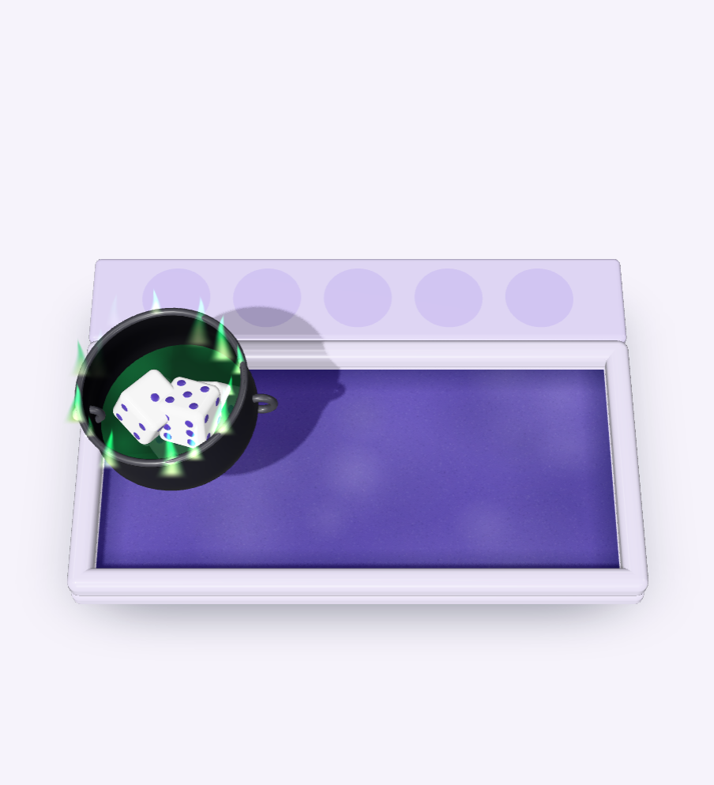
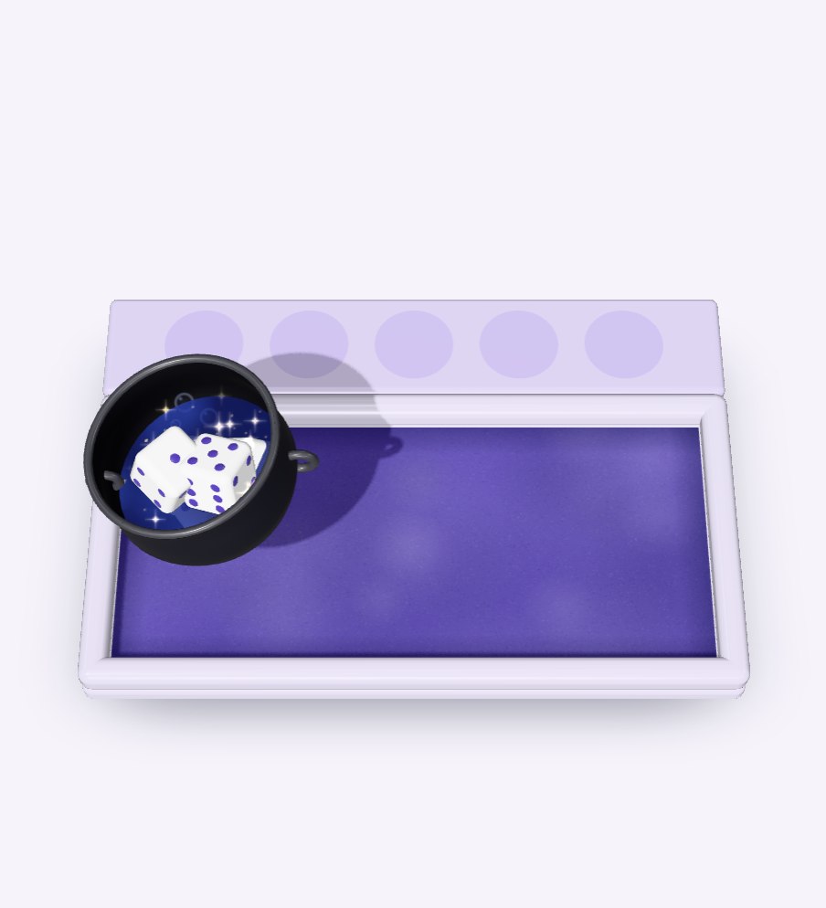
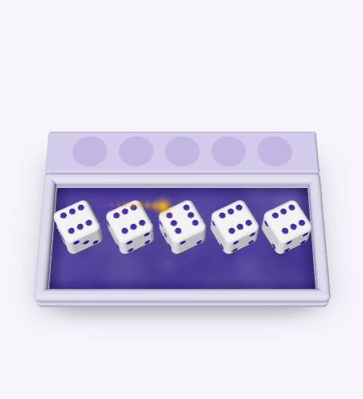

# Task 03 Proofs - Brews and the Yatzy effects

## Task Summary

This task fills the cauldron with the roller's brew: a liquid surface in the brew's colors and rising particles from one small GPU shader, fading out as the cauldron tips to pour. Starwater also shoots a comet across the tray on a Yatzy. It flips `available` to true for the nine items of this spec.

## What This Task Proves

- All four brews draw inside the cauldron, the dice show through the liquid, and the empty cauldron of today is unchanged when no brew is equipped.
- Swamp has slow bubbles, Violet Murk a light smoke, Witchfire green flames around the rim, Starwater glitter and bubbles plus a comet on a Yatzy.
- The catalog marks exactly the five skins and four brews available; pets and celebrations are untouched.

## Evidence Summary

- Screenshots below from headless Chromium on SwiftShader, `?shake=1` holding the cauldron out.
- `Brew.test.ts` (fade with tip, the comet's path and length), `particles.test.ts` (seeded layout on the surface and the rim) and the catalog test in `look.test.ts` pass.

## Artifact: The default cauldron

**What it proves:** No brew equipped: the empty black cauldron, as before.

**Why it matters:** The default must not change.

## Artifact: The four brews

| Brew        | Cauldron out                            |
| ----------- | --------------------------------------- |
| Swamp       |             |
| Violet Murk |  |
| Witchfire   |     |
| Starwater   |     |

**What it proves:** Each brew's liquid and particles draw in the cauldron, with the dice still visible.

**Why it matters:** Each is a distinct, cozy look: murky, smoky, green fire, and a night sky in a pot.

**Command:** `?lab&shake=1&quality=high&cosmetics=brew:<id>`.

## Artifact: The starwater comet

 

**What it proves:** On a Yatzy a golden comet with a trail flies across the tray, drawn solid so it also shows on the pale page.

**Why it matters:** It is the legendary brew's payoff. `Brew.test.ts` checks its path runs steadily across and stays above the felt.

## Artifact: Catalog flags

**What it proves:** `look.test.ts` asserts all five `DICE_SKINS` and all four `BREWS` are available and that the renderer and catalog list the same ids.

**Command:** `pnpm exec vitest run apps/web/src/cosmetics`

**Result summary:** All pass.
