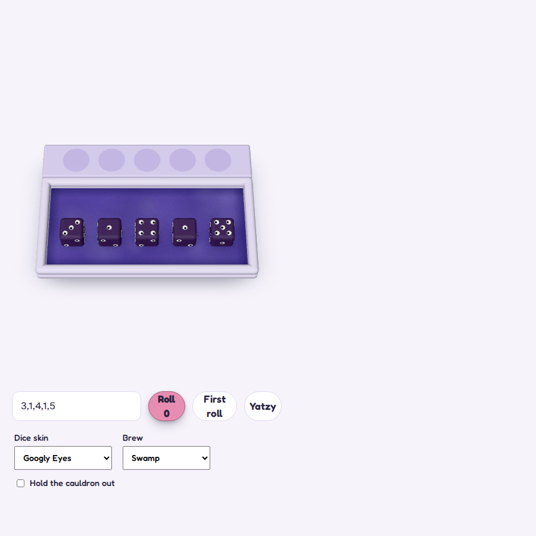

# Task 04 Proofs - Lab pickers, dev override, screenshots and performance notes

## Task Summary

The dice lab (`?lab`) gets a skin picker, a brew picker, a Yatzy button and a "Hold the cauldron out" toggle; `?cosmetics=diceSkin:gilded,brew:witchfire` sets them at load, and the same override applies to the real game's tray. Both exist only on the dev server and in `VITE_LAB=1` builds.

## What This Task Proves

- Every item can be previewed and a Yatzy triggered without the server.
- The pickers start from the URL override.
- Production builds ignore the override (`labEnabled()` is false there, so the game never reads it).
- All gates pass.

## Evidence Summary

The screenshot is `?lab&cosmetics=diceSkin:googly,brew:swamp`: the pickers read "Googly Eyes" and "Swamp", and the tray draws googly dice. A Playwright check printed the selected values `["googly","swamp"]`.

## Gate results

| Command                    | Result                                                                          |
| -------------------------- | ------------------------------------------------------------------------------- |
| `task lint`                | exit 0                                                                          |
| `task typecheck`           | exit 0                                                                          |
| `task test`                | exit 0; 30 files, 402 tests; `packages/rules` at 100% in all four measures       |
| `task build`               | exit 0                                                                          |
| `E2E_PORT=8092 task e2e`   | exit 0 (see the validation report for the count)                                |

## Performance notes

No GPU was available, so real frame rates were not measured. The choices below are by construction.

- **Draw calls.** Default: 2 meshes a die. Bone, obsidian, moonstone and gilded: still 2 a die (gilded adds one 5-vertex `Points` for glints, shown only during a Yatzy). Googly: 3 a die (body, sclera, pupils). A brew adds one liquid mesh and at most two particle `Points`, and starwater one 15-vertex comet `Points` (hidden except in flight).
- **Particles.** Swamp 9, Violet Murk 7, Witchfire 14, Starwater 16 plus 6. All move on the GPU from one time uniform; no per-frame CPU work except the comet's 15 vertices during its 1.15 s flight and the glints' 5.
- **Textures.** Bone grain 128 by 128, moonstone glow 64 by 64, liquid 128 by 128 (one per brew in use). No image files and no network.
- **Materials.** Moonstone avoids `transmission` (an extra render pass); it uses an emissive map and iridescence on rich GPUs only. Without a GPU (`renderQuality() === 'low'`) every skin uses plain standard materials and gilded drops its metalness so it does not go black.
- **Idle redraw.** The scene renders on demand. Only googly and moonstone redraw at rest, about 15 times a second, not when the page is hidden and not with reduced motion.
- **Reduced motion.** The existing scene shows no cauldron at all under reduced motion, so brews do not appear. If it ever did, the particles hold one still moment and there is no comet. Skins hold their eyes centered, the glow steady and skip glints.
