# Task 02 Proofs - Sprite system, placeholder art and the Nano Banana prompt sheet

## Task Summary

This task builds how a pet is drawn: one sprite per pet per pose, loaded from real art when a file exists and otherwise drawn as a vector placeholder, animated with `motion`, standing where the dice scene's camera says the tray frame's back-right corner is. It also adds the dev bench (`?pets`) that the screenshots come from, and the prompt sheet for the real art. The pets are not hooked to the game yet (task 3).

## What This Task Proves

- All 13 sprites (3 poses for the toad, cat and bat, 4 for the ghost cheerleader) draw, each differently, and read at small size on the light and dark themes.
- A real `webp` dropped into `apps/web/src/art/pets/<pet>/<pose>.webp` replaces just that pose, with no code change, and the other poses keep their placeholders.
- The motion is calm and real (checked while it was moving), and reduced motion gives a still frame per pose.
- `nano-banana-prompts.md` has 13 pet prompts and one parade prompt with exact save paths.

## Evidence Summary

- 31 test files, 424 tests pass (`pnpm exec vitest run`), including `artIndex`, `petMotion`, `placement` and render tests for every pet and pose (`renderToString`).
- Screenshots below are real captures from the dev server on port 5193 (Chromium, Playwright, `?pets` bench). Static poses were captured with reduced motion on, so they are still frames; two captures were taken deliberately mid-animation and are labelled so.
- A real bug was found by looking at the live motion rather than the tests: `AnimatePresence initial={false}` stopped every animation inside the pet after its first render. The computed transform stayed `none`; after removing `initial={false}` it moves (`matrix(... -19.9)` during a cheer hop). The ghost's pose captures were retaken afterwards.

## Artifact: every sprite, light and dark

**What it proves:** all 13 placeholders at the size they are drawn in the bench (4.5rem).

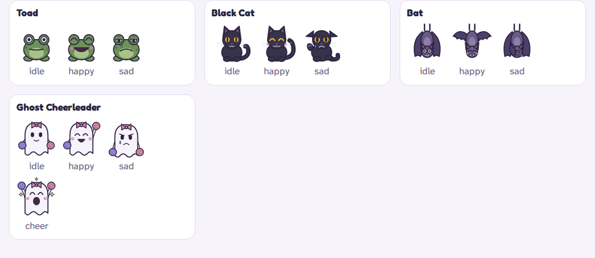

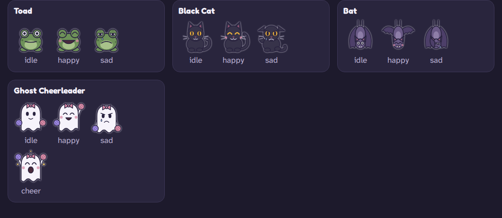

## Artifact: each pet in each pose, standing on the tray (dark theme, reduced motion, so a still frame)

| Pet               | idle                                    | happy                                    | sad                                    | cheer                                    |
| ----------------- | --------------------------------------- | ---------------------------------------- | -------------------------------------- | ---------------------------------------- |
| Toad              | 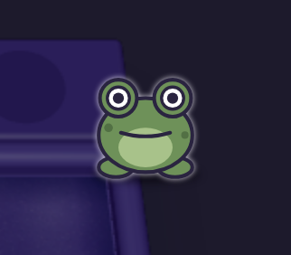             | 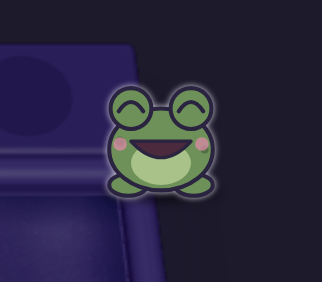             |              | (shown as happy)                         |
| Black Cat         | 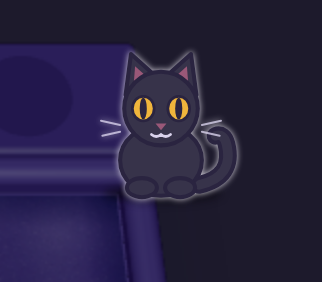         | 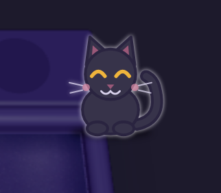         | 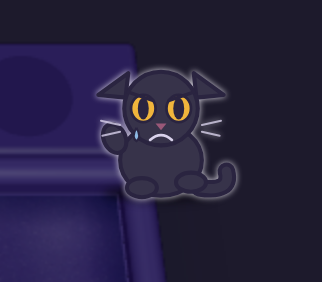         | (shown as happy)                         |
| Bat               | 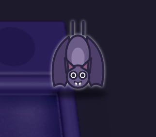              | 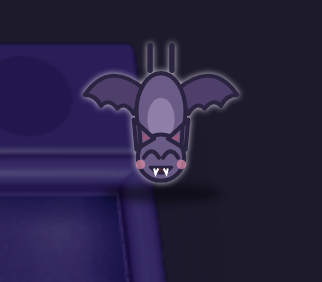              | 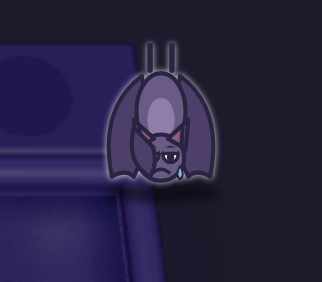              | (shown as happy)                         |
| Ghost Cheerleader |  | 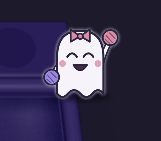 | 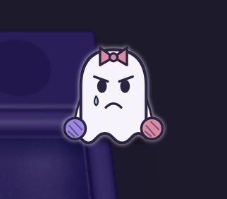 | 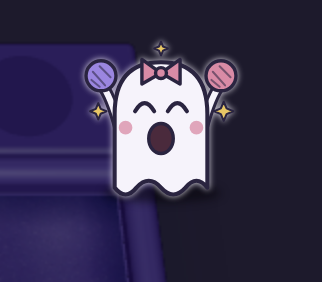 |

## Artifact: mid-animation (not a still frame)

The legendary ghost during its cheer hops, light theme, no reduced motion. Captured 400 ms after pressing "cheer"; the body's computed transform at that moment was `matrix(1.026, 0.0225, -0.0238, 0.9687, 0, -6.1)` (lifted and squashed, mid-hop).

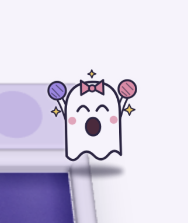

## Artifact: real art drops in with no code change

A temporary `apps/web/src/art/pets/toad/happy.webp` (a copy of an existing sticker, used only to prove loading, deleted afterwards) replaced the toad's happy pose; its sad pose kept the vector placeholder (the check printed 1 placeholder svg in the tray after pressing "sad").

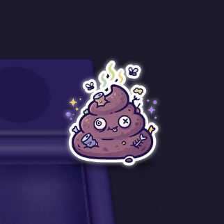

## Artifact: prompt sheet

`docs/specs/04-spec-pets-and-celebrations/nano-banana-prompts.md`: a common style block taken from the existing stickers (thick plum outline, cel shading, rose cheeks, white die-cut border), then one prompt per asset with its exact save path, and a checklist table of the 14 files.
