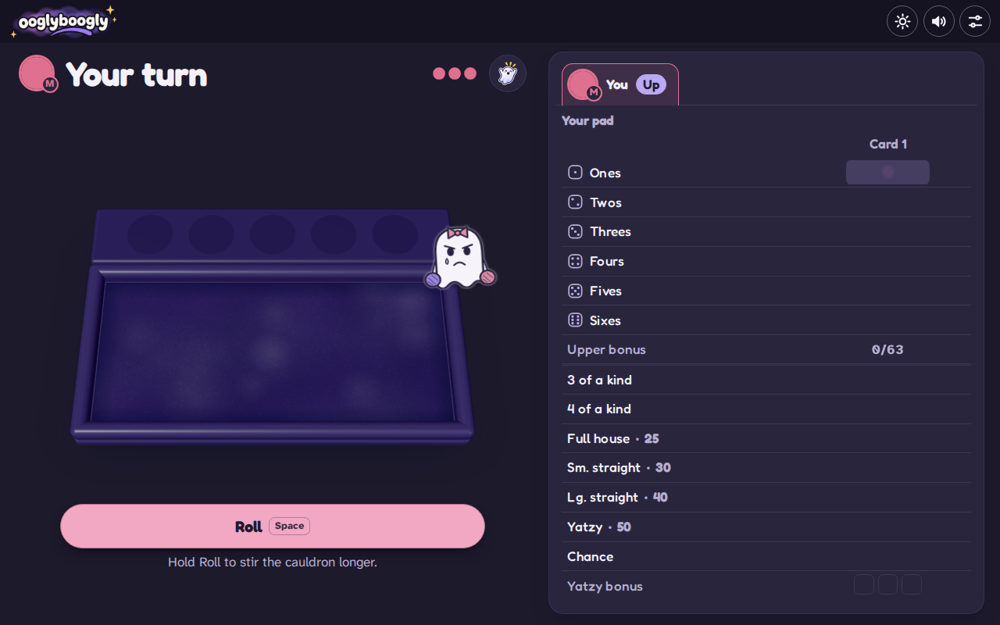
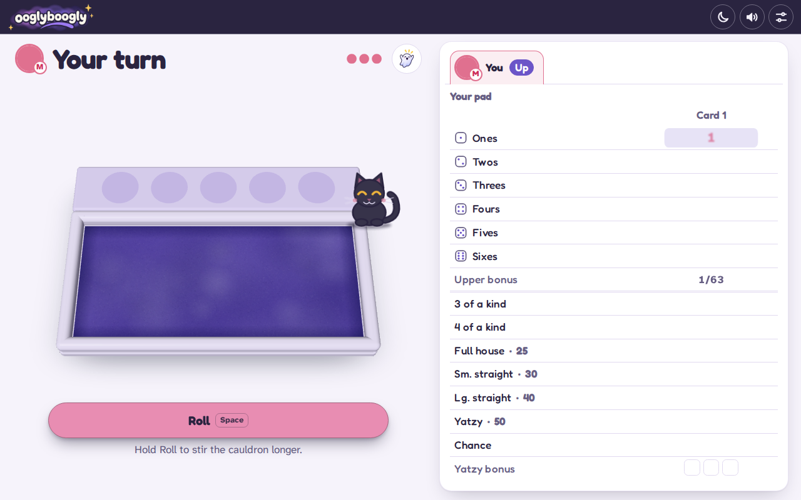
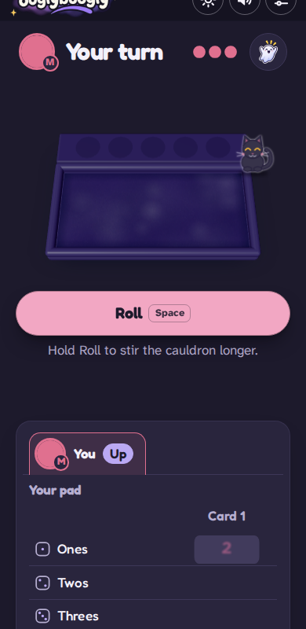

# Task 03 Proofs - Pets on screen, driven by the game and `seat.equipped`

## Task Summary

This task connects the pets to the real game. `Game.tsx` gains one hook (`usePetStage`) and a small wrapper around the dice tray that also holds the pet layer. The hook compares each new replayed game state with the last one, turns what changed into pet reactions, and decides whose pet is on show. The pet reads `seat.equipped.pet` (and `celebration`); nothing on the server or in the protocol changed.

## What This Task Proves

- In a real game against the real server, the equipped pet stands on the tray, stays idle until something happens, goes sad when a 0 is written and happy when a positive score is written, and settles back to idle by itself.
- Whose pet shows follows the rule in the spec: Take turns, whoever just acted until the reaction ends, then whoever is up; Everyone at once, the tray player's, reacting only to their moves. These are pure functions with tests.
- With nothing equipped no pet is drawn (the layer renders empty). The e2e test for that is in task 5.

## Evidence Summary

- `stage.test.ts` (11 tests) and the existing mood tests pass; the whole suite is 424 tests, 0 failures.
- The screenshots below are from a real two-process run: a production build made with `VITE_LAB=1` served by the real server on port 8094 with guest login, driven by Playwright. The pet was equipped with `?cosmetics=pet:ghostCheerleader` (the server cannot equip yet; that is spec 02).
- The printed poses from the run: idle before any move, `sad` 500 ms after writing a 0, and `idle` again 3 s later. A second run printed `happy` 450 ms after a positive score.

## Artifact: stage logic

**Command:**

```bash
pnpm exec vitest run apps/web/src/cosmetics/pets/stage.test.ts
```

**Result summary:** passes; covers the parade firing only for the player with the Yatzy and only with the celebration on, once per Yatzy; reaction rules for Take turns and Everyone at once; handing the pet over; unknown pet ids showing nothing.

## Artifact: the ghost cheerleader goes sad after a 0 (dark, desktop)

Captured 500 ms after writing a 0 into Ones, so mid-reaction (the pet had not settled back yet).



## Artifact: the black cat is happy after a positive score (light, desktop)



## Artifact: phone width (dark)

The pet scales with the tray and stays inside it.


