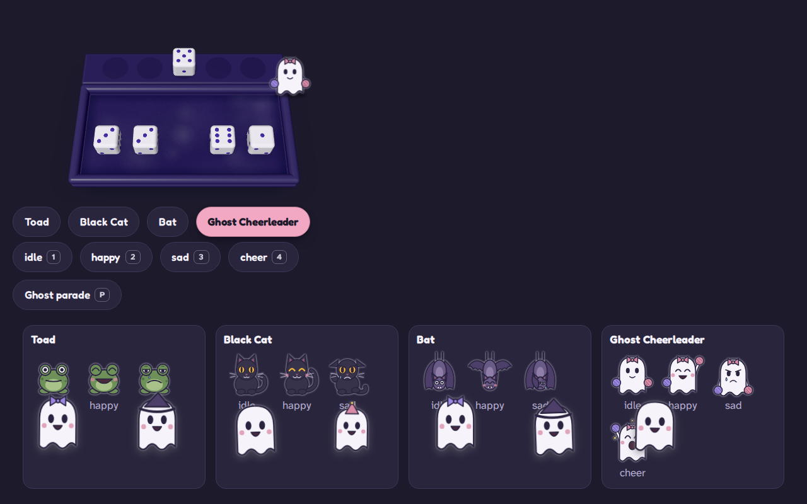
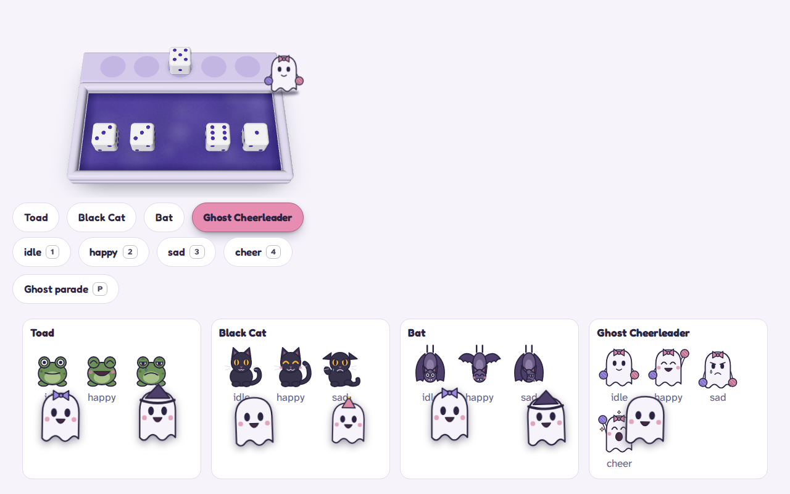
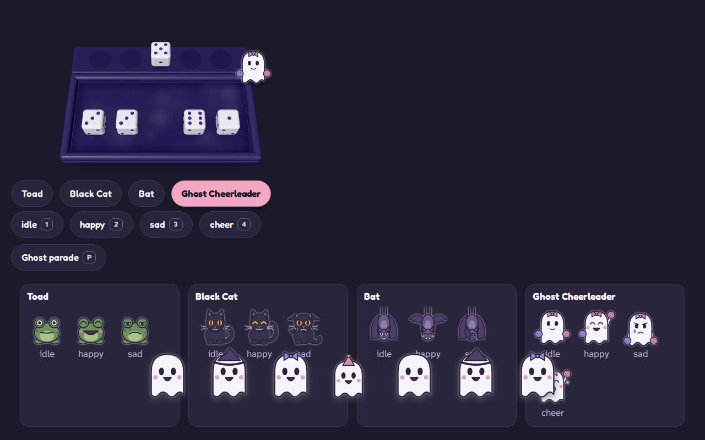

# Task 04 Proofs - Ghost Parade

## Task Summary

This task adds the Ghost Parade: a line of seven little ghosts (some in a witch hat, a bow or a party hat) that walks across the whole screen when a player whose seat has `celebration: ghostParade` gets a Yatzy, on every client, then is removed from the page. It is a fixed, click-through layer driven by CSS keyframes, so the Yatzy `Sparkles`, the "Yatzy!" word and the sticker floats are untouched and keep working. `Game.tsx` mounts it from the same hook as the pets.

## What This Task Proves

- The parade marches, bobbing and spaced out, then leaves the DOM by itself (about 7.3 s).
- With reduced motion the ghosts stand in a row for about 3 s and go, with no marching or bobbing.
- One Yatzy is one parade (pure-function tests in `stage.test.ts` and `mood.test.ts`), and a replay or reconnect fires nothing.
- In a real game against the real server, a real Yatzy made the parade appear on both the roller's screen and a second, watching browser (see below).

## Evidence Summary

- `paradePlan.test.ts` (5 tests) and `GhostParade.test.tsx` (4 tests) pass; the suite is 433 tests, 0 failures.
- Screenshots are real captures on the dev server (port 5193, `?pets` bench, key P). The mid-march ones were taken deliberately 2.8 s after starting, mid-animation: the ghosts' left edges were measured at 865, 707, 549, 391, 234, 76 and -82 px (the last one still stepping on, ahead of the line).
- Real game, honestly reported: I drove a real table (production build with `VITE_LAB=1`, real server on port 8094, guest login, `?cosmetics=pet:ghostCheerleader,celebration:ghostParade`) by Playwright, holding the most common die each turn until a Yatzy came. It came on turn 10 of one game. The script waited for `[data-testid="ghost-parade"]` on both the roller's page and a second browser that joined after the start as a watcher, and both appeared. The script then, because of slow software-rendered screenshots, sampled too late: it found the parade already gone and the cheer already settled, and after writing the Yatzy score a reload showed no parade. A second attempt at a screenshot of the real-game parade did not hit a Yatzy within its time limit, so there is no screenshot of a real-game parade; the bench captures below are the visual proof, and the real-game run proves only that the wiring fires on a real Yatzy for roller and watcher.

## Artifact: mid-march (dark)

Captured mid-animation, 2.8 s after pressing P.



## Artifact: mid-march (light)



## Artifact: reduced motion

Captured 600 ms in. The run printed 7 ghosts, the `still` class present, and the parade gone from the page after 3.1 s.



## Artifact: tests

```bash
pnpm exec vitest run apps/web/src/cosmetics
```

Covers the plan (seven ghosts, one stepping off after another, fixed hats and bobs, duration), the render (seven vector ghosts, announcement text, `aria-hidden` line, still variant, real strip art replacing the ghosts) and the one-Yatzy-one-parade rule.
