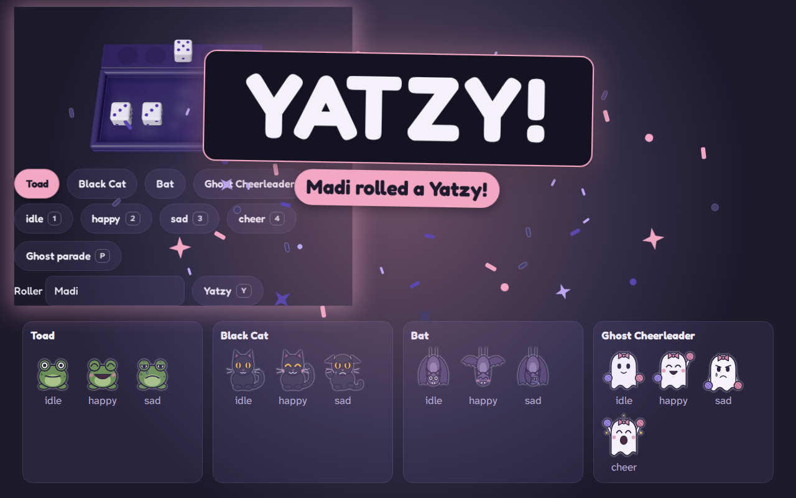
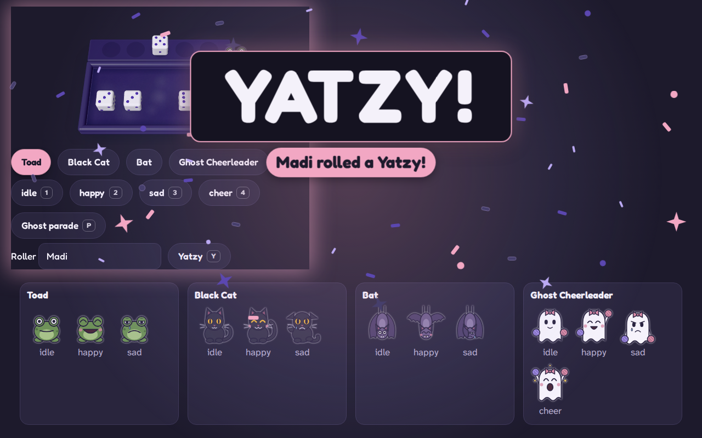
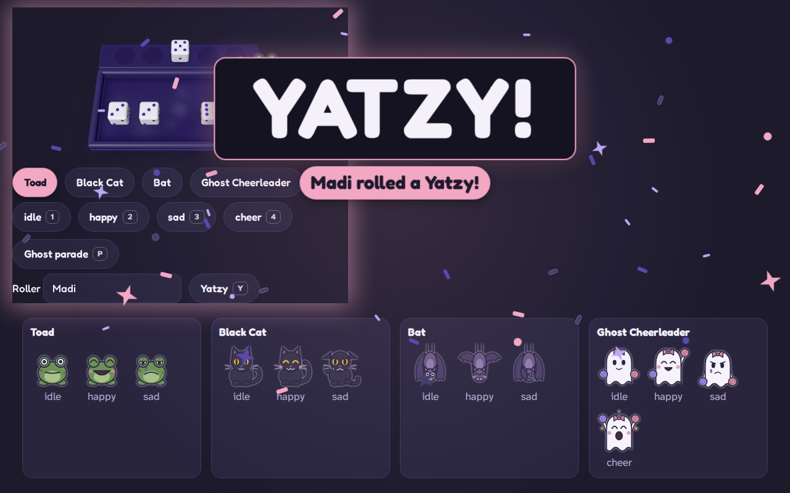
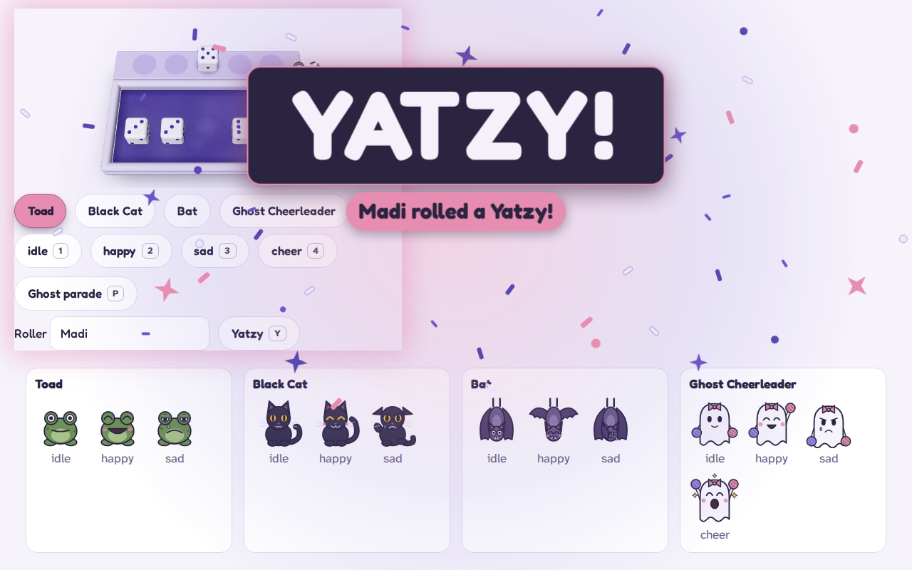
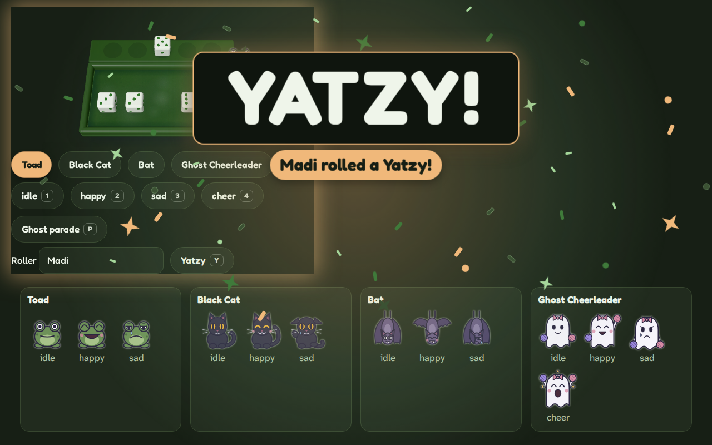
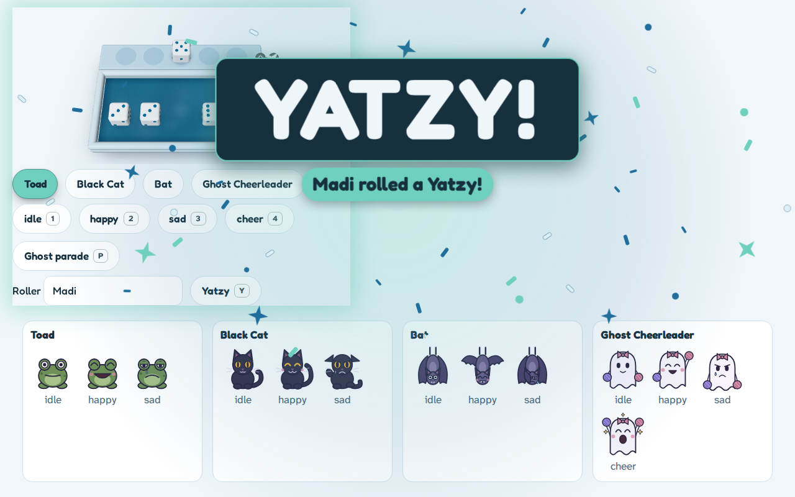
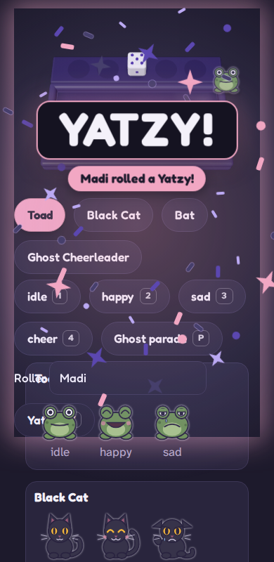
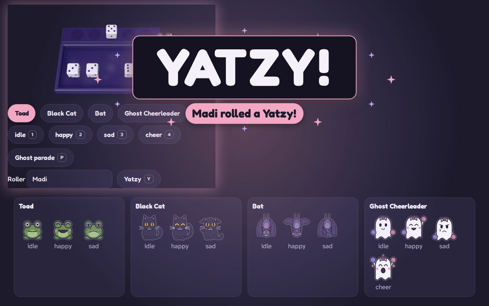
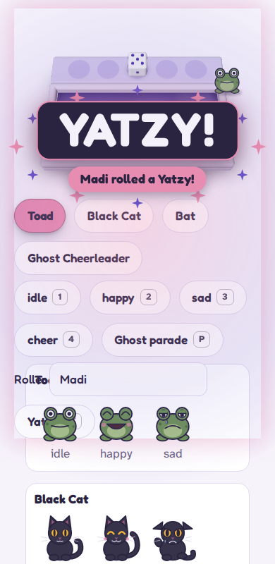

# Task 02 Proofs - The celebration component, CSS and fanfare

## Task Summary

This task adds the big Yatzy celebration itself: a fixed, click-through overlay with a glow, 54 palette-colored confetti pieces, a large Fredoka `YATZY!` banner with a `<Name> rolled a Yatzy!` pill, a tray glow and shake, a reduced-motion version (banner plus a still ring of 12 stars), and the synthesized fanfare in `sound.ts`.

## What This Task Proves

- The look: a burst of thin strips, dots and four-point stars in the app's own pink, lavender and plum, on a dark plate with a pink border. Witchy and cozy, no gold, rainbow or glitter.
- It works in both themes and the three schemes, and at phone width.
- With reduced motion there is no flying confetti: 0 pieces, 12 still stars.
- It is click-through (`pointer-events: none`, measured), announces politely (`role="status"`, `aria-live="polite"`) and clears itself.
- The text pairings are `on-band` on `band` and `on-accent` on `accent`, both already in `TEXT_PAIRS`, so `palette.test.ts` covers them in light and dark and all three schemes (it passes).

## Evidence Summary

- Tests: `plan.test.ts` (confetti pattern is fixed, 54 pieces, palette colors only, all three shapes, finishes inside the 3.6 s; durations; announcement text; fanfare finishes inside the celebration and the quiet one is quieter; silent without throwing before audio is unlocked) and `YatzyCelebration.test.tsx` (`renderToString`: status role, aria-live, hidden confetti, 54 pieces, no buttons or links inside, reduced ring of 12 and no pieces, two names).
- The screenshots below are real captures on the dev bench (dev server, port 5199, `?pets` page, key Y; the bench itself arrives in task 4, which is why the screenshots were taken from that code). Each file name carries the time the screenshot was really taken after the key press (software-rendered screenshots are slow: I aimed at 450 ms and got about 800 ms, so I renamed the files to the measured times).
- The tray column glows, and the shake runs for 520 ms at the start, so it is over before most of these shots.
- One real bug was found by looking at the first screenshots: the bench mounted the overlay inside the shaking tray column, and a `translate` on a parent makes it the containing block of a fixed child, so the banner was trapped in a 547 px box. The bench now portals it to the body; in the game it is mounted outside the column.
- Another was found by measuring, see the long-task table.

## Artifact: burst, dark (taken about 0.8 s, 1.4 s and 2.2 s after the press)







## Artifact: burst, light (about 1.1 s)



## Artifact: other schemes (about 1.1 s)





## Artifact: phone width, 390 px (about 0.9 s)



## Artifact: reduced motion (about 0.9 s, and 0.7 s on the phone)

The run printed `pieces 0, stars 12` and the celebration was gone from the page by 2.7 s (the timer is 2.5 s).






## Artifact: main-thread long tasks (PerformanceObserver `longtask`)

Measured with `longtask.mjs` in this folder: the bench page open for 3 s first, then the key press, then 4.5 s of observation, in a fresh Chromium (software rendering), with and without 4x CPU throttling. Times are in ms after the press.

| Run                   | Long tasks while it plays                     |
| --------------------- | --------------------------------------------- |
| Baseline, nothing, 1x | none                                          |
| Burst, 1x             | none                                          |
| Reduced motion, 1x    | none                                          |
| Baseline, nothing, 4x | none                                          |
| Burst, 4x             | one of 56 ms at 2 ms (mounting the 54 pieces) |
| Reduced motion, 4x    | none                                          |

What it took to get there, honestly: my first version kept the cue state in the page that holds the 3D tray. That produced long tasks of 55 to 200 ms at the start and the end (re-rendering the tray scene), and an experiment showed the CSS alone cost nothing, so the cause was React re-rendering. Moving the state into its own component (`YatzyStage`, `YatzyBench`) took the 1x worst case from 186 ms to 55 ms, and `contain: strict` on the overlay plus `will-change: opacity` on the glow took it to none at 1x. The run is noisy (an earlier 4x run showed 120 ms at the same spot), so the worst figure I report is 120 ms under 4x throttling and 55 ms unthrottled; I do not claim zero.

## Artifact: tests

```bash
pnpm exec vitest run apps/web/src/celebrations apps/web/src/theme
```

**Result summary:** all pass, including `palette.test.ts`.

## Reproduce

`pnpm -F @rollhouse/web exec vite --port 5199`, then `node shots.mjs` and `node longtask.mjs` (the scripts here are saved as `.txt` so the repo linter ignores them: copy them without the `.txt`; Playwright is in `e2e/node_modules` and they import it by path).
