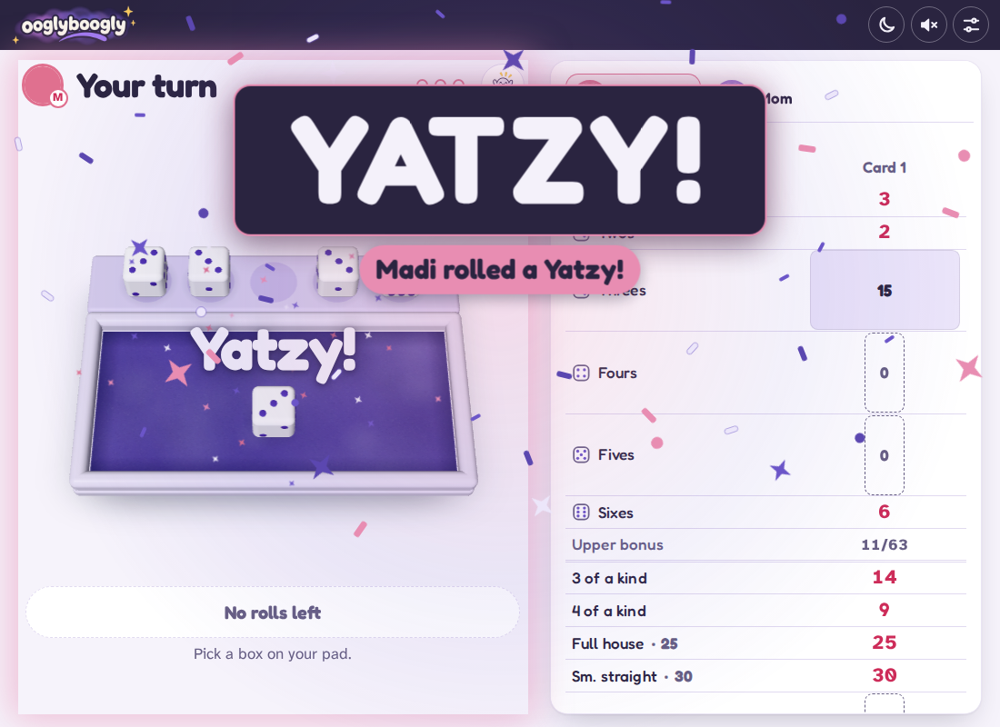
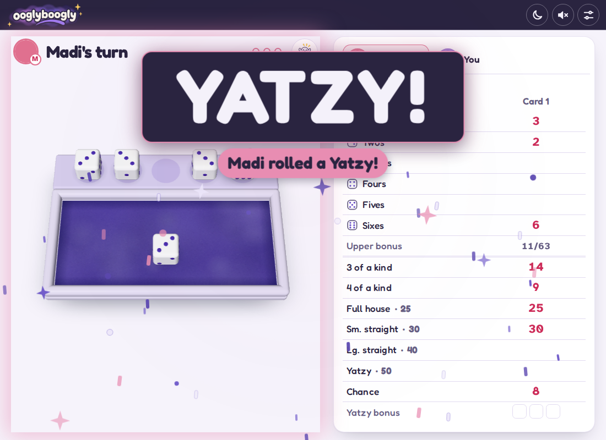
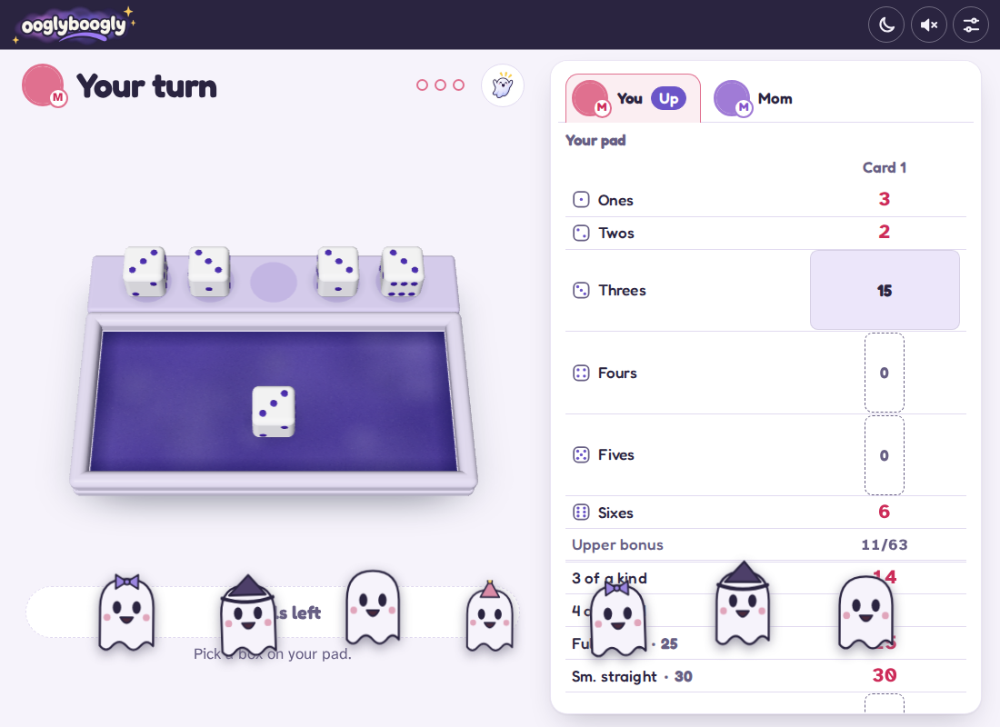

# Task 03 Proofs - Wiring into Game.tsx with the parade coordination

## Task Summary

This task puts the celebration on the game screen. `Game.tsx` gets one import and one mount (`YatzyStage`, replacing the old Ghost Parade mount). `YatzyStage` runs `useYatzyCelebration`, which compares each new replayed `game` with the last and plays the celebration (and the fanfare) once per `yatzyRollsBetween` result. If the roller has the Ghost Parade equipped, the parade plays right after the burst, not together with it.

## What This Task Proves

- In a real game against the real server, a real Yatzy made the celebration appear on the roller's screen and on a second player's screen, 46 ms after the dice landed, naming the roller.
- The burst ended and the equipped parade started in the same frame on both screens (the parade was forced on every seat with `?cosmetics=celebration:ghostParade`, the dev override from spec 04).
- Reloading the roller's page afterwards (a reconnect: the same move log replayed) played neither the celebration nor the parade.
- Game.tsx's footprint is one import and one mount; the cue state lives in `YatzyStage`, so starting and clearing it re-renders nothing else on the game screen.

## Evidence Summary

- Tests: `YatzyStage.test.tsx` (nothing renders for a first state, which is what a reconnect or snapshot gives; the parade renders when no burst is playing), plus the whole of Task 1 for the firing rules.
- Real run: `realgame.mjs.txt` in this folder. Production build made with `VITE_LAB=1` (so the `?cosmetics=` override works), real server on port 8102 with a throwaway data folder, guest login, two Chromium browsers at one table ("Madi" and "Mom", Take turns, 1 card). Madi held the most common face each roll and wrote in the best box; Mom rolled once and took the first box. The 9th turn gave Madi a real Yatzy (the game's own in-tray "Yatzy!" text agrees, and Threes previews 15).
- Output of the run, as printed: `celebration seen on Madi, Mom: true, true after 46 ms`. The page-side logger (a requestAnimationFrame loop) recorded, in `performance.now()` ms:
  - Madi: celebration on 156279, off 159888 (3.6 s), ghost parade on 159888, off 167434.
  - Mom: celebration on 154627, off 158765 (4.1 s, her screen was drawing the same 3D roll in software on one shared CPU), ghost parade on 158765, off 166400.
  - After reload: `celebration on page: 0 parade: 0`.
- A real Yatzy happened on turn 9 of the first game I ran, so I report one, not a selection of several.

## Artifact: the roller's screen, just after the roll landed

Taken 300 ms after the celebration was seen. The existing in-tray `Yatzy!` text and sparkles are still there beneath the new banner, as intended.



## Artifact: the other player's screen, same moment

Mom is not the roller; her screen says `Madi's turn` and shows the same banner naming Madi.



## Artifact: the roller's screen after the burst, the equipped parade marching

Taken 4.5 s after the first shot (after the burst had cleared).



## Main-thread long tasks in the real game: what I can and cannot say

The real game is not quiet in this environment. The run recorded over 300 long tasks per browser over the whole game, of 200 to 640 ms, even in turns without a celebration (two Chromium windows drawing software-rendered 3D rolls on one shared CPU, plus my screenshots), and one of 4.2 s at page load. Long tasks overlapping the celebration window were 526, 548, 363 and 629 ms on Madi's screen and 480, 493, 641 and 341 ms on Mom's, which is the same range as turns with no celebration, so this run cannot separate the celebration's cost from the game's. The controlled measurement is in the task 2 proofs (the bench has the same real 3D tray): none unthrottled, 56 ms worst at 4x CPU throttling. I did not run a second real game to compare matched windows; that is the missing piece, and I say so rather than claim zero in the live game.

## Artifact: tests

```bash
pnpm exec vitest run apps/web/src/celebrations
```

**Result summary:** all pass.

## Reproduce

Build with `VITE_LAB=1 pnpm -r build`, start the server (`PORT=8102 WEB_DIST=../apps/web/dist GUEST_LOGIN=true DATA_DIR=<tmp> node apps/server/dist/index.mjs`), then run `realgame.mjs` (saved as `.txt`) with the table name not containing `lab` (that word opens the dice bench).
